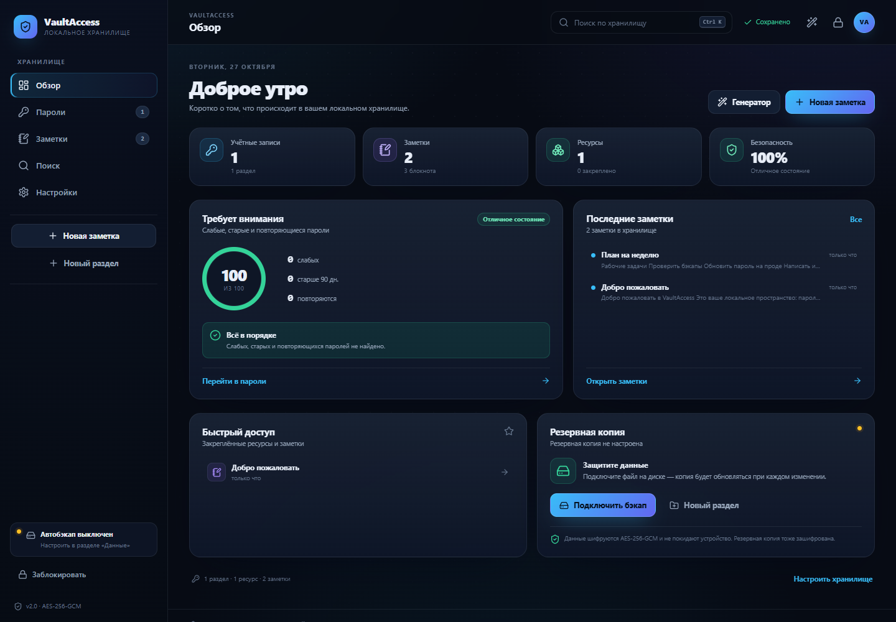
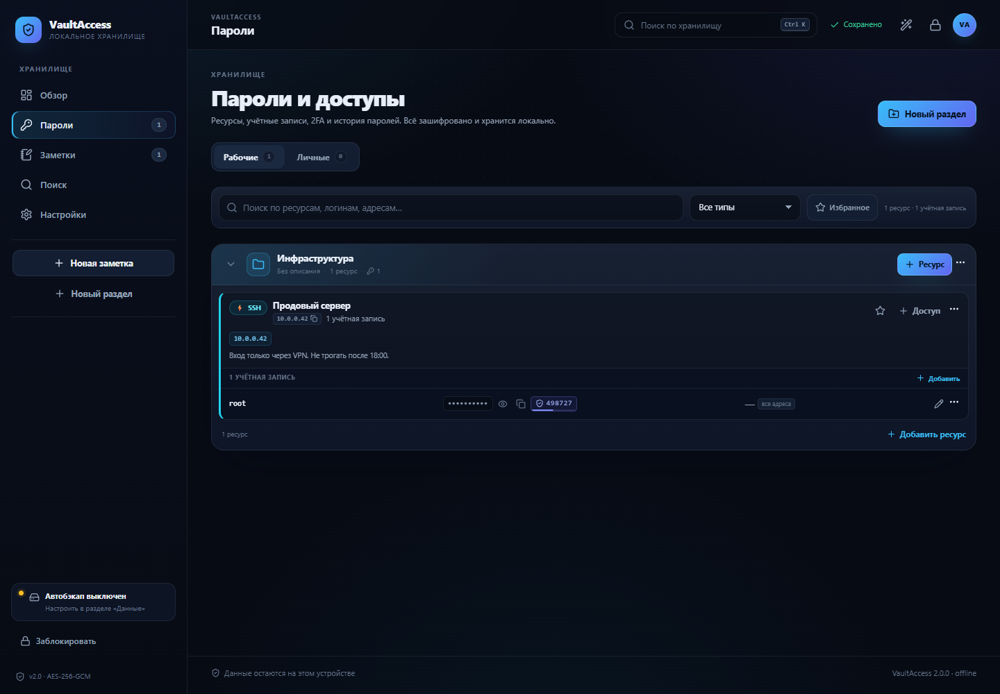
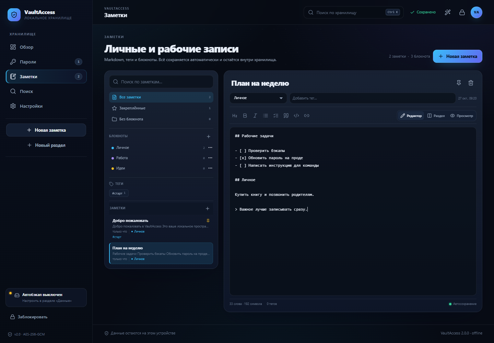
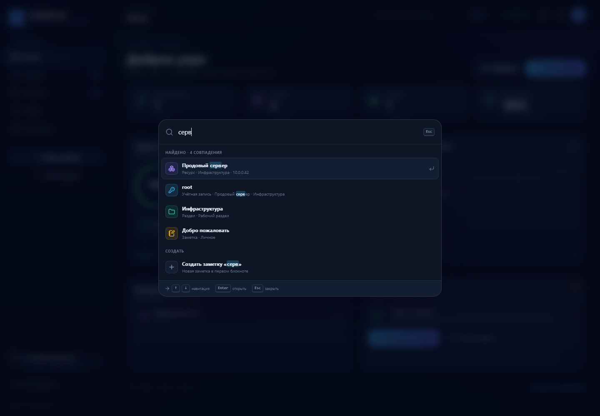
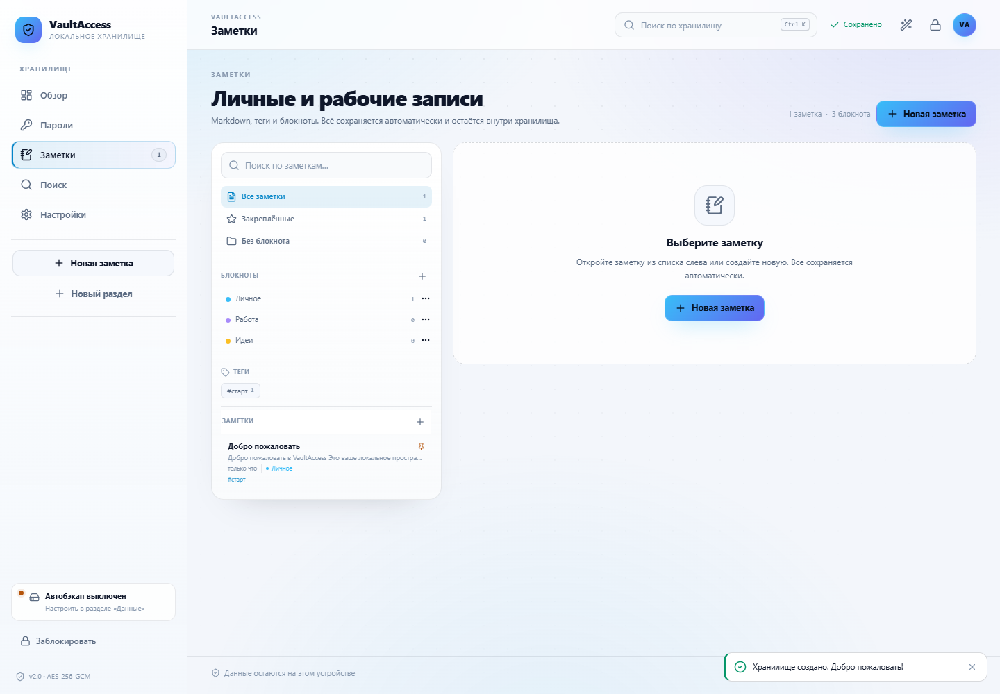
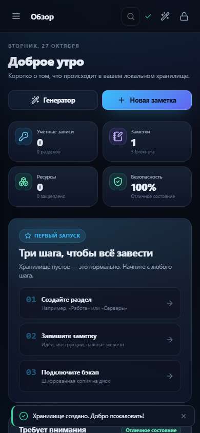
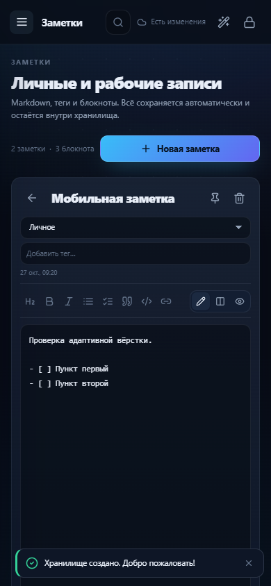
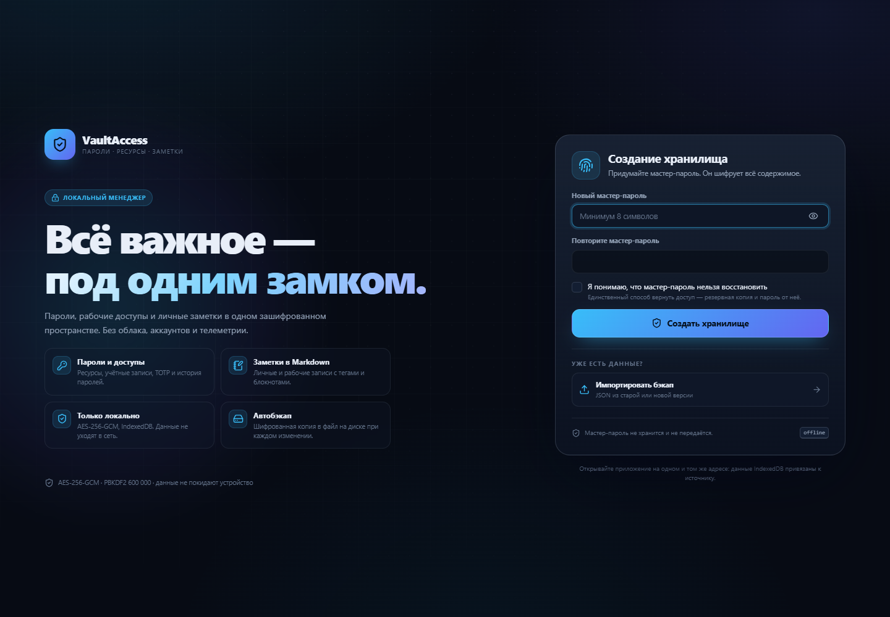
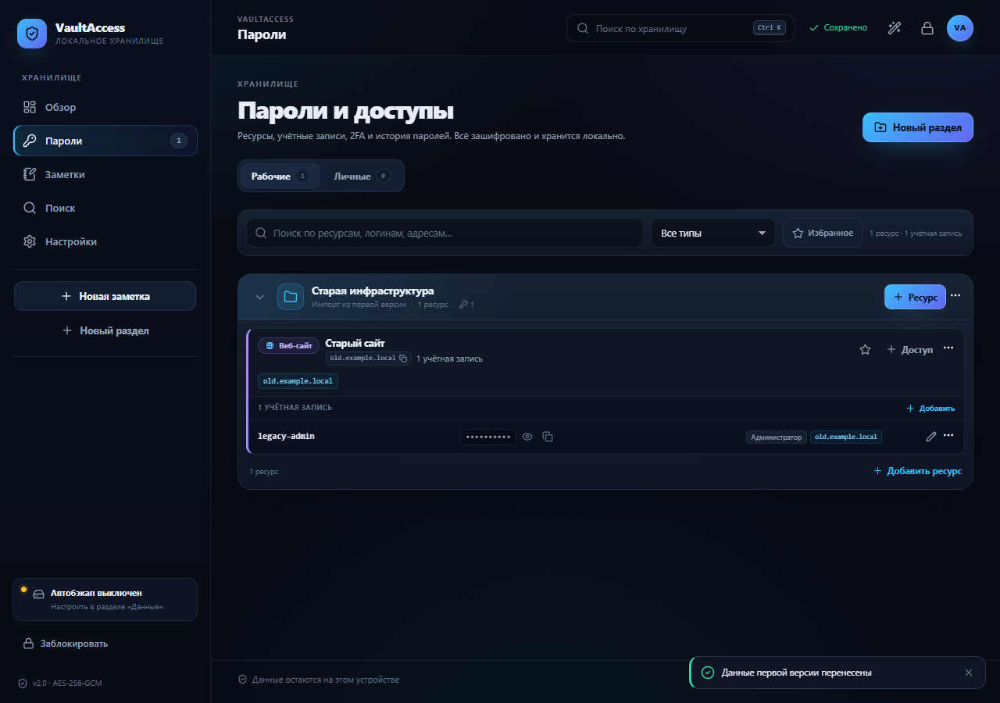
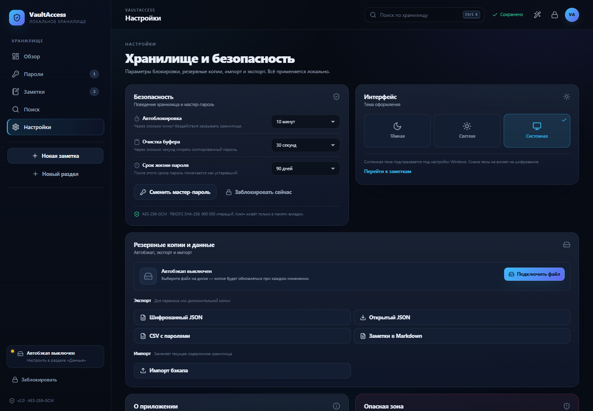

# VaultAccess 2.0

**Локальный менеджер паролей, рабочих доступов и заметок.** Один зашифрованный сейф в браузере: без облака, аккаунтов, серверов и телеметрии. Данные не покидают устройство.



## Что внутри

- **Пароли и доступы** — разделы «Рабочие» и «Личные», ресурсы (RDP, 1С, VPN, WEB, БД, SSH, заметки), учётные записи с логином, паролем, ролью, привязкой к адресам, TOTP и историей смены паролей.
- **Заметки** — блокноты, теги, Markdown-редактор с просмотром и разделённым режимом, автосохранение, закрепление, поиск.
- **Обзор** — статистика, оценка безопасности, слабые/старые/повторяющиеся пароли, последние заметки, закреплённое и состояние бэкапа.
- **Поиск** — полнотекстовый по логинам, адресам, ресурсам, заметкам и разделам; `Ctrl + K` открывает командную палитру с действиями.
- **Безопасность** — AES-256-GCM, PBKDF2-SHA-256 (600 000 итераций), автоблокировка, очистка буфера обмена, смена мастер-пароля, локальный генератор паролей.
- **Бэкапы** — автобэкап в файл на диске (Chromium), шифрованный JSON, импорт, открытый JSON/CSV/Markdown для переноса.
- **Оформление** — тёмная, светлая и системная темы; адаптивная вёрстка для телефона.
- **Один файл** — `npm run build:single` собирает автономный `dist-single/index.html`, который открывается двойным щелчком и работает офлайн.

| Пароли | Заметки |
| --- | --- |
|  |  |

| Командная палитра | Светлая тема |
| --- | --- |
|  |  |

| Мобильный обзор | Мобильный редактор |
| --- | --- |
|  |  |

## Быстрый старт



Нужен [Node.js](https://nodejs.org/) 20 или новее. Для работы самого приложения Node не нужен — только для сборки.

### Вариант 1. Один HTML-файл (рекомендуется)

```bash
npm install
npm run build:single
```

Откройте `dist-single/index.html` двойным щелчком. Это полностью автономная сборка: стили, иконки и код внутри одного файла, внешних запросов нет. Работает с `file://` в Chrome, Edge и других Chromium-браузерах.

На Windows после сборки можно запускать `start.cmd` — он откроет готовый файл.

> **Важно:** IndexedDB привязана к источнику (origin). Файл, открытый по разным путям, может считаться разным хранилищем. Держите `index.html` в одном месте и делайте резервные копии. Для переноса на другой компьютер используйте шифрованный JSON.

### Вариант 2. Dev-сервер

```bash
npm install
npm run dev
```

Откройте адрес из терминала (обычно `http://localhost:5173`).

### Обычная сборка

```bash
npm run build
npm run preview
```

`dist/` можно раздать любым статическим сервером. Помните: `localhost:5173`, `localhost:4173`, `file://` и GitHub Pages — **разные хранилища**. Выберите один адрес и не меняйте его без экспорта/импорта.

## Перенос из старой версии

Старая версия — это `passwords.html` в корне репозитория. Она оставлена без изменений, чтобы можно было выгрузить данные.

### Способ 1. Через шифрованный JSON (работает всегда)

1. Откройте старый `passwords.html` в том же браузере.
2. Разблокируйте хранилище.
3. Меню **«Данные» → «Шифрованный JSON»** — сохраните файл.
4. Откройте новый VaultAccess. На экране создания нажмите **«Импортировать бэкап»**.
5. Выберите файл, введите **старый** мастер-пароль и задайте **новый** мастер-пароль.

Новый пароль будет шифровать уже новое хранилище. Старый файл бэкапа при этом продолжает открываться старым паролем.

### Способ 2. Автоматическое обнаружение старой базы

Если браузер видит старую IndexedDB на том же origin, на экране создания появится кнопка **«Перенести старую базу»**. Введите мастер-пароль старой версии — данные перенесутся, а пароль останется прежним (потом его можно сменить в настройках).

Этот способ зависит от того, как браузер изолирует `file://` и localhost. Если кнопки нет — используйте способ 1.



Что переносится: разделы, ресурсы, учётные записи, привязки к IP, история паролей, TOTP-секреты и настройки видимости. Ресурсы-заметки с текстом дополнительно становятся настоящими заметками.

## Скрипты

| Команда | Что делает |
| --- | --- |
| `npm run dev` | Запускает Vite с горячей перезагрузкой |
| `npm run build` | Проверяет типы и собирает `dist/` |
| `npm run build:single` | Собирает автономный `dist-single/index.html` |
| `npm run preview` | Предпросмотр production-сборки |
| `npm run typecheck` | Только проверка TypeScript |
| `npm test` | Unit-тесты (Vitest) |
| `npm run test:watch` | Тесты в режиме наблюдения |

## Тесты

```bash
npm test
```

46 тестов покрывают:

- AES-GCM/PBKDF2: шифрование, расшифровку, неверный пароль, уникальные IV, base64;
- TOTP: векторы RFC 6238, base32, otpauth-ссылки, таймер;
- генератор и оценку надёжности паролей;
- нормализацию и миграцию данных;
- преобразование старого формата `passwords.html`;
- полнотекстовый поиск (включая проверку, что пароли не индексируются);
- Markdown и санитизацию HTML (XSS).

## Безопасность

Подробности — в [SECURITY.md](SECURITY.md). Кратко:

- мастер-пароль не хранится; из него выводится неизвлекаемый ключ AES-256-GCM;
- PBKDF2-SHA-256, 600 000 итераций, случайная соль 16 байт;
- каждый save использует новый случайный IV (12 байт);
- всё содержимое хранится одним шифрованным блоком в IndexedDB (`vaultaccess_v2`);
- ключ живёт только в памяти вкладки и обнуляется при блокировке;
- пароли не попадают в поисковый индекс;
- Markdown-превью санитизируется через DOMPurify;
- приложение не делает сетевых запросов и не содержит телеметрии.

**Мастер-пароль нельзя восстановить.** Единственный путь назад — резервная копия и пароль от неё. Делайте бэкапы и храните их отдельно от устройства.



## Структура проекта

```text
.
├─ index.html                  # HTML-оболочка Vite
├─ passwords.html             # старая версия, оставлена для миграции
├─ src/
│  ├─ core/                   # крипто, сессия, IndexedDB, поиск, миграция
│  │  ├─ crypto.ts            # AES-GCM + PBKDF2
│  │  ├─ session.ts           # состояние хранилища, save/lock/unlock
│  │  ├─ idb.ts               # обёртка IndexedDB
│  │  ├─ backup.ts            # автобэкап в файл
│  │  ├─ legacy.ts            # импорт версии 1
│  │  ├─ search.ts            # полнотекстовый поиск
│  │  ├─ password.ts          # генератор
│  │  ├─ strength.ts          # оценка надёжности
│  │  ├─ totp.ts              # RFC 6238
│  │  ├─ defaults.ts          # схема по умолчанию и нормализация
│  │  └─ types.ts             # модели данных
│  ├─ features/
│  │  ├─ vault/               # разделы, ресурсы, учётки, модалки
│  │  ├─ notes/               # список, Markdown-редактор, блокноты
│  │  ├─ dashboard/           # обзор и аудит
│  │  ├─ search/              # страница поиска
│  │  ├─ settings/            # настройки, смена пароля, бэкапы
│  │  ├─ backup/              # импорт бэкапа и миграция
│  │  └─ generator/           # генератор паролей
│  ├─ layout/                 # AppShell, Sidebar, Topbar, LockScreen, палитра
│  ├─ hooks/                  # useSession, useAutoLock, useTOTP, useCopy…
│  ├─ ui/                     # кнопки, поля, модалки, тосты, Markdown
│  ├─ styles/                 # токены, layout, компоненты, страницы
│  ├─ App.tsx
│  └─ main.tsx
├─ screenshots/               # изображения для README
├─ .github/workflows/ci.yml   # typecheck + tests + build
├─ SECURITY.md
└─ LICENSE
```

### Как добавить новый тип ресурса

1. Добавьте значение в `ASSET_TYPES` и подписи в `src/core/types.ts`.
2. При необходимости расширьте `Asset` и `normalizeAsset` в `src/core/defaults.ts`.
3. Добавьте поля в `AssetModal` (`src/features/vault/VaultModals.tsx`) и отображение в `AssetCard.tsx`.
4. Обновите CSV-экспорт и тесты.

### Как добавить новый раздел

1. Создайте компонент в `src/features/<name>/`.
2. Добавьте маршрут в `src/layout/AppShell.tsx` и пункт в `Sidebar`.
3. Если нужны данные — расширьте `VaultData`, `normalizeVault` и `session`.

## Резервные копии и данные

- **Автобэкап** — Chrome/Edge, через File System Access API. При каждом сохранении пишется тот же шифрованный JSON-конверт.
- **Ручной экспорт** — «Настройки → Резервные копии и данные».
- **Шифрованный JSON** — рекомендованный формат: пароли и заметки внутри зашифрованы мастер-паролем.
- **Открытый JSON/CSV/Markdown** — только для осознанного переноса. Эти файлы не защищены.
- **Импорт** заменяет текущее содержимое хранилища. Сначала сделайте бэкап.
- **Удаление** стирает IndexedDB этого браузера. Файлы бэкапов остаются.

## Как выложить на GitHub

```bash
git init
git add .
git commit -m "feat: VaultAccess 2.0"
git branch -M main
git remote add origin https://github.com/USER/REPO.git
git push -u origin main
```

CI из `.github/workflows/ci.yml` запустит typecheck, тесты и обе сборки. Артефакт `dist-single` можно скачать из Actions.

Если включить GitHub Pages, приложение будет доступно по `https://USER.github.io/REPO/`. Это удобно для демо, но помните: данные в браузере на GitHub Pages не связаны с локальным файлом. Для личного использования надёжнее локальная сборка.

## Ограничения

- Однопользовательское локальное приложение: нет синхронизации между устройствами и облака.
- IndexedDB привязана к origin; смена адреса/пути создаёт новое пустое хранилище.
- Автобэкап в файл поддерживается не всеми браузерами; ручной экспорт работает везде.
- TOTP считается по стандартным 6 цифрам/30 секундам.
- Нет автоматического импорта из Chrome/KeePass/1Password — только JSON и старый формат VaultAccess.
- Мастер-пароль невосстановим.

## Идеи для развития

- E2E-синхронизация через WebDAV/Nextcloud/Syncthing с шифрованным файлом.
- PWA-установка и офлайн-кэш.
- Вложения и изображения в заметках.
- Проверка утечек по k-anonymity (Have I Been Pwned) — опционально и только по сети.
- Импорт из браузеров и KeePass.
- Passkeys/WebAuthn для разблокировки.
- Задачи и календарь на базе заметок.
- Журнал действий и более тонкий аудит безопасности.
- Расширение браузера для автозаполнения.

## Лицензия

MIT. См. [LICENSE](LICENSE).
